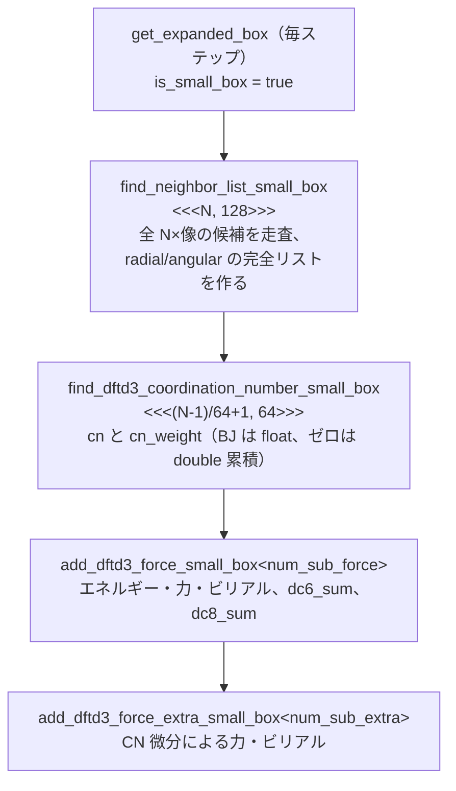
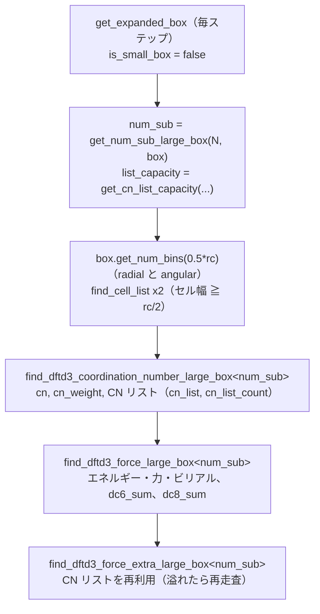
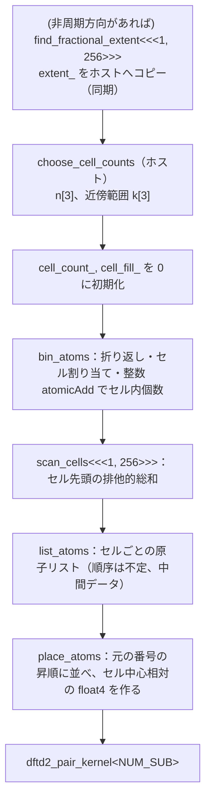

# 第4章 ソースコード構成

本章は、`dftd3`（BJ ダンピングとゼロダンピング D3(0)）と `dftd2`（Grimme 2006 の表、QE 互換の表、単純打ち切り）を実装しているソースコードの構成を、開発者向けに説明します。理論式は 02 章、最適化の考え方と却下した案は 05 章、検証結果は 06 章にあります。

**対象のリビジョン**：`develop` `90bff065`（upstream/master `aa63ffdd` をマージした後）の作業ツリー。本章の行番号はすべてこのリビジョンのものです。ソースを変更すると行番号はずれます。upstream のサブフォルダ再構成（VER-0027）より前の版では、`dftd3.cu`、`dftd3.cuh`、`dftd3para.cuh`、`nep.cu`、`nep_charge.cu`、`nep_charge_vdw.cu`、`nep_multigpu.cu` は `src/force/` 直下にありました。履歴上の記述（VER 記録など）は当時のパスのままです。

出典の略記は次の通りです。

| 略記 | 意味 |
|---|---|
| `D3:n` | `src/force/dftd3/dftd3.cu` の n 行目 |
| `D3h:n` | `src/force/dftd3/dftd3.cuh` の n 行目 |
| `DZ:n` | `src/force/dftd3/dftd3zero_table.cuh` の n 行目 |
| `P3:n` | `src/force/dftd3/dftd3para.cuh` の n 行目 |
| `D2:n` | `src/force/dftd2.cu` の n 行目 |
| `D2h:n` | `src/force/dftd2.cuh` の n 行目 |
| `QT:n` | `src/force/dftd2qe_table.cuh` の n 行目 |
| `VER-xxxx`、`DES-xxxx`、`ADR-xxxx`、`DR-xxx` | `specs/` の検証記録・設計書・決定記録・要求仕様 |

「推論」「導出」とあるものは、コードや記録から本マニュアル作成者が導いたもので、実行して確認していません。

## 4.1 ファイル一覧と役割

### 本体

D3 のファイルは upstream の再構成でサブフォルダ `src/force/dftd3/` に入りました。フォーク固有の D2 のファイルは `src/force/` 直下に残っています（人間の決定、VER-0027）。

| ファイル | 内容 | 行数 |
|---|---|---|
| `src/force/dftd3/dftd3.cu` | クラス `DFTD3` の実装。全 D3 カーネル、減衰の共通ヘルパー（`d3_damped_pair`、`d3_zero_term`）、BJ の汎関数パラメータ表（`initialize`）、キーワードの構文解析（`DFTD3::parse_damping`）、元素検査（`DFTD3::check_elements`）、ホスト側の制御（`compute`、`compute_small_box`、`compute_large_box`） | 2084 |
| `src/force/dftd3/dftd3.cuh` | クラス `DFTD3` の宣言（パラメータ構造体、メンバー、GPU バッファ） | 106 |
| `src/force/dftd3/dftd3para.cuh` | 定数 `Bohr`、`Bohr2`、`HartreeBohr6`、`max_elem=94`、`max_cn=5`、`max_cn2=25`、`__constant__` の `num_cn`、`cn_ref`、`r2r4`、`covalent_radius`、ホスト側の `c6_ref_cpu[111625]`（`P3:22-24, 26-28, 29, 34, 76, 90, 104`）。値の出典はコードに書かれていません（UPSTREAM-0002 G） | 12507 |
| `src/force/dftd3/dftd3zero_table.cuh` | **生成ファイル（DR-003）**。`__constant__ float d3zero_r0ab[4465]`（D3(0) のペア半径 R0、Å、下三角の詰め込み、`DZ:24`）と、ゼロダンピングの汎関数表 `D3ZERO_PARAMS[48]`（名前、`s6`、`sr6`、`s8`、`sr8`、`DZ:433-440`）。ヘッダに生成元（dftd3-lib のコミット `3c99ee98`、`lib/core.f90`、VER-0023）が書かれている。`dftd3.cu` からだけ include される | 489 |
| `src/force/dftd2.cu` | クラス `DFTD2` の実装。D2 の全カーネル、構文解析（`parse_tokens`、`find_in_run_input`）、初期化（ペアパラメータ表の構築）、元素検査、`compute` | 1058 |
| `src/force/dftd2.cuh` | クラス `DFTD2` の宣言（`Options`、メンバー、GPU バッファ） | 90 |
| `src/force/dftd2para.cuh` | **生成ファイル**。`DFTD2_C6_EV_A6[87]`、`DFTD2_R0_A[87]`（添字は原子番号 Z、`DFTD2_MAX_Z 86`）。Grimme 2006 の表（`table grimme2006`）。ヘッダに dftd3-lib `prg/extras.f90` の `loadoldpar` への参照が書かれている | 207 |
| `src/force/dftd2qe_table.cuh` | **生成ファイル（DR-004）**。QE 7.2 の C6（最初の参照点、Eh bohr⁶）`DFTD2QE_C6_EH_BOHR6[3741]`（`QT:16`）と `r0ab`（Å）`DFTD2QE_R0AB_A[3741]`（`QT:956`）。いずれも倍精度の `static const`、Z ≤ 86（`DFTD2QE_MAX_Z 86`、`DFTD2QE_NUM_PAIRS 3741`、`QT:10-11`）。`table qe` で使う | 1894 |
| `tools/Miscellaneous/dftd2/generate_dftd2para.py` | `dftd2para.cuh` の生成スクリプト。C6 は CSV の `c6_eV_A6` 列をそのまま、R0 は CSV の `r0_A` の 1.1 倍 | － |
| `tools/Miscellaneous/dftd2/generate_dftd2qe_table.py` | `dftd2qe_table.cuh` の生成スクリプト。`generate_dftd2qe_table.py <QE の dft-d3 ソースのディレクトリ> <出力 .cuh>`。入力は qe-7.2（コミット `b4c5e8de`）の `dft-d3/pars.f90`（C6）と `dft-d3/core.f90`（`setr0ab`）で、数値は `repr()` で書き出す（倍精度が往復する）。手で打った値はありません | － |

D3(0) の表（`dftd3zero_table.cuh`）の生成スクリプト `gen_d3zero_tables.py` は `tools/` ではなく `specs/verification/VER-0023-dftd3-zero-parameters/scripts/` にあります（VER-0023、A3 章）。

`dftd2qe_table.cuh` の添字は `zl·(zl+1)/2 + zs`（0 始まりの原子番号、`zs ≤ zl`、下三角の詰め込み。3741 = 86·87/2）で、`d3zero_r0ab` と同じ詰め込み方です。`dftd2.cu` の冒頭に `static_assert` があり、QE の表が `DFTD2_MAX_Z` までの下三角を覆っていることを検査します（`D2:62-64`）。

### 既存ファイルへのフック（フォークでの追加・変更）

upstream/master（`aa63ffdd`）との差分（`git diff aa63ffdd --stat -- src`）は 18 ファイルで、上の新規ファイル（`dftd3.cu` を含む）を除けば小さな追加だけです。

| ファイル | 追加内容 |
|---|---|
| `src/force/nep/nep.cu` / `nep.cuh` | メンバー `DFTD3 dftd3; DFTD2 dftd2; bool has_dftd3, has_dftd2;`（`nep.cuh:141-142, 181-184`）、`initialize_dftd3()`、`initialize_dftd2()`、`compute()` 末尾の呼び出し（4.2 節） |
| `src/force/nep_charge/nep_charge.cu` / `nep_charge.cuh` | 同上（`NEP_Charge`、`nep_charge.cuh:157-158, 189-192`） |
| `src/force/nep_charge_vdw/nep_charge_vdw.cu` / `.cuh` | `dftd2` のみ（`.cuh:159-160`）。`dftd3` はエラー（`nep_charge_vdw.cu:148-150`） |
| `src/force/nep/nep_multigpu.cu` | `dftd3` / `dftd2` があればエラー（`nep_multigpu.cu:49-56`） |
| `src/force/nep_spin/runtime.cu` | upstream のスピン NEP 用のコマンド検査 `Spin_Runtime::check_command` の「非対応コマンド」の一覧に `dftd3` が入っている（`runtime.cu:56`）。**フォークの変更ではなく upstream 側の記述**で、`dftd3` は NEP-spin でエラーになる（コード読解。`dftd2` はこの一覧になく、NEP-spin との組み合わせは未確認） |
| `src/force/force.cuh` | `all_potentials_are_nep()`、`has_any_potential()`（`force.cuh:96-105`） |
| `src/main_gpumd/run.cu` / `run.cuh` | `has_seen_dftd3_command`、`has_seen_dftd2_command`（`run.cuh:58-59`）、キーワード検査、`check_dftd2_potential()`（`run.cuh:54`） |
| `src/utilities/gpu_macro.cuh` | `gpuGetDevice` の追加（HIP は 45 行目、CUDA は 134 行目）。upstream/master との差分はこの 2 行だけです（`git diff aa63ffdd`） |
| `src/force/neighbor.cu` / `.cuh` | **D3 専用ではない共有コード**。大箱経路が `find_cell_list`（ストリーム引数なしの版、`neighbor.cu:167-218`）を使います。本フォークでの変更はありません（`git diff aa63ffdd` に出ません） |

`src/model/box.cuh:84` の `apply_mic(box, float&...)`（最小イメージ規約）と `src/model/box.cu:80-109` の `Box::get_num_bins`（補助関数 `get_num_bins_one_direction` を含む）も大箱経路が使う共有コードです。

`src/main_replica`（`gpumd_replica`）には D3/D2 のコードがありません（`grep -ril dftd src/main_replica` で該当なし）。`makefile` と CMake は `src/force/*.cu` と `src/force/*/*.cu` を glob で拾うため（`src/makefile:60-61`、`CMakeLists.txt:27-28`）、`src/force/dftd2.cu` も `src/force/dftd3/dftd3.cu` も、新ファイルを追加してもビルド定義の変更は不要です（AGENTS.md「Build」）。サブフォルダの更に深い階層に置くとこの glob では拾われません。

## 4.2 NEP / NEP_Charge への組み込み

### 初期化

`NEP`、`NEP_Charge` のコンストラクタの末尾で、`initialize_dftd3(run_input)` と `initialize_dftd2(run_input)` が呼ばれます（`nep.cu:370-371`、`nep_charge.cu:459-460`）。したがって、起動メッセージ（01 章 1.5 節）は `dftd3` / `dftd2` の行を読んだ時点ではなく、**`potential` 行を処理してポテンシャルを構築した時点**で出ます。

| 処理 | `NEP`（`src/force/nep/nep.cu`） | `NEP_Charge`（`src/force/nep_charge/nep_charge.cu`） |
|---|---|---|
| `dftd3` の探索 | `run_input.lines()` を全行走査し、最初に見つかった `dftd3` 行を使う（`nep.cu:48-68`） | 同（`nep_charge.cu:146-166`） |
| 構文検査 | `DFTD3::parse_damping(tokens)`（`D3:2036-2056`）。トークン数が 4 未満なら `dftd3 must have 3 parameters ...`、6 以上なら `dftd3 has too many parameters ...`、5 番目が `zero` / `bj` 以外ならエラー（いずれも `exit(1)`）。4 トークンなら `bj`（`nep.cu:55`、`nep_charge.cu:153`） | 同 |
| 引数の取得 | 汎関数名、`rc_potential`、`rc_coordination_number`（`get_double_from_token` の戻りを `float` に変換、`nep.cu:56-58`） | 同 |
| ポテンシャルファイルと減衰 | `get_first_potential_filename(run_input)`（**最初の** `potential` 行のファイル）と減衰の種類を `DFTD3::initialize` に渡す（`nep.cu:59-64`、`nep_charge.cu:157-162`） | 同 |
| `dftd2` | `DFTD2::find_in_run_input`（`D2:751-767`）で全行走査し、トークンは `DFTD2::parse_tokens`（`D2:675-749`）で解析する。原子番号配列は `zbl.atomic_numbers`（型ごと）から作り、`DFTD2::initialize(s6, rc, options, atomic_numbers)` に渡す（`nep.cu:70-83`） | 同（`nep_charge.cu:168-181`） |

`run.in` の全行を走査するため、`dftd3` / `dftd2` は `run` の後に書いても有効です（回帰ケース `dftd3_single_late`、4.6 節）。

D3 が元素情報を **NEP ファイルの 1 行目の元素記号**から取る（`find_atomic_number`、`D3:500-535`。`DFTD3::initialize` の末尾から呼ばれる、`D3:2032`）のに対し、D2 は NEP が持つ原子番号（`zbl.atomic_numbers`）を使います。複数の `potential` を指定した場合も、D3 の元素表は最初のファイルのものです（そのとき型の対応がどうなるかは、コードからは確認できず、未検証です）。

### compute() での呼び出し位置

NEP の力・エネルギー・ビリアルの計算が終わった**後**に、D3、続いて D2 を呼びます。どちらも per-atom 配列に `+=` で加算します（01 章 1.6 節）。

| クラス | 呼び出し箇所 |
|---|---|
| `NEP::compute`（2 つのオーバーロード） | `nep.cu:1270-1277`、`nep.cu:1740-1747` |
| `NEP_Charge::compute` | `nep_charge.cu:2009-2016` |
| `NEP_Charge_VDW::compute`（D2 のみ） | `nep_charge_vdw.cu:2089-2092` |

```cpp
// nep.cu:1270-1277（NEP::compute の末尾。両者は排他なので実際にはどちらか一方）
  if (has_dftd3) {
    dftd3.compute(
      box, type, position_per_atom, potential_per_atom, force_per_atom, virial_per_atom);
  }
  if (has_dftd2) {
    dftd2.compute(
      box, type, position_per_atom, potential_per_atom, force_per_atom, virial_per_atom);
  }
```

`NEP_Charge_VDW` は `dftd3` を受け付けません（`nep_charge_vdw.cu:148-150`）。`dftd2` は組み込みの vdW 項とは独立に加算されます（`nep_charge_vdw.cu:346-357`、二重計上はユーザー責任）。`NEP_MULTIGPU`（`nep4*` で GPU が 2 枚以上見えるとき、`force.cu:142-166` の分岐）は `dftd3` / `dftd2` のどちらがあってもエラーにします（`nep_multigpu.cu:49-56`）。

### run.cu の検査

| 検査 | 場所 |
|---|---|
| `dftd3` の重複、`dftd2` との併用 | `run.cu:363-370` |
| `dftd2` の重複、`dftd3` との併用、トークン構文（`DFTD2::parse_tokens`） | `run.cu:371-381` |
| `dftd2` 行の時点で既にポテンシャルがあれば `check_dftd2_potential()` | `run.cu:382-384` |
| `run` 行の処理の先頭、および run.in 末尾での `check_dftd2_potential()` | `run.cu:512`、`run.cu:196` |
| `check_dftd2_potential()` の本体：`dftd2` があるのに `!force.all_potentials_are_nep()` ならエラー | `run.cu:501-507` |

`dftd3` については、ポテンシャルの種類の検査が**ありません**（`run.cu:363-370` はキーワードの出現を数えるだけ）。NEP 系以外のポテンシャルでは `dftd3` は黙って無視されます（01 章、UPSTREAM-0002 G）。`all_potentials_are_nep()` は、ポテンシャルが 1 つ以上あり、すべて NEP 系であるときだけ真です（WPE ビルドでは常に偽、`force.cuh:96-104`）。`dftd3` の構文（トークン数、減衰の種類）は `run.cu` では検査せず、ポテンシャルの構築時に `DFTD3::parse_damping` が検査します。

対応ポテンシャルの一覧は 01 章 1.3 節の表を参照してください。

## 4.3 クラス・メンバー・GPU バッファ

### クラス DFTD3（`D3h:22-106`）

| メンバー | 型 | 内容・サイズ |
|---|---|---|
| `dftd3_para` | `DFTD3_Para { float s6, s8, a1, a2; int damping; float sr6, sr8; int atomic_number[94]; }`（`D3h:25-34`） | カーネルに値渡しされる。`damping` は 0 = BJ、1 = ゼロダンピング。`a1`、`a2` は BJ のみ使う。`sr6`（既定 0）、`sr8`（既定 1）はゼロダンピングのみ使う（R0 のスケール、α6 = 14、α8 = 16 は定数）。`atomic_number` は 0 始まり（H = 0）。BJ の `a2` は Å に換算済み（`D3:1508`）。ゼロダンピングでは `s6`、`sr6`、`s8`、`sr8` を `D3ZERO_PARAMS` からそのまま入れる（`D3:1935-1945`） |
| `enabled`、`rc_radial`、`rc_angular` | bool、float、float | `rc_radial` = `rc_pot`、`rc_angular` = `rc_cn`（`D3:1924-1925`）。既定値 15、10 は `initialize` で上書きされる |
| `elements_checked` | bool | ゼロダンピングのとき、最初の `compute` で原子種を検査したかどうか（`D3h:43`、4.4 節 `check_elements`）。`initialize` で偽に戻る（`D3:2033`） |
| `cn` | `GPU_Vector<float>` | N 個。配位数（ゼロダンピングの小箱でも float で保持、5.4 節） |
| `cn_weight` | `GPU_Vector<float>` | **N × `max_cn` = 5N 個**（1 原子あたり 20 B）。C6 補間のガウス重み（5.4 節） |
| `c6_ref` | `GPU_Vector<float>` | 111625 個 = 4465 元素対 × 25。`initialize` で `c6_ref_cpu` から転送（`D3:2029-2030`） |
| `dc6_sum`、`dc8_sum` | `GPU_Vector<float>` | 各 N 個。力カーネルが `=` で書き、extra カーネルが読む |
| `cn_list` | `GPU_Vector<int>` | 大箱のみ。容量 × N × `num_sub` 個 |
| `cn_list_count` | `GPU_Vector<int>` | 大箱のみ。N × `num_sub` 個 |
| `NN_radial`、`NN_angular` | `GPU_Vector<int>` | 小箱のみ。各 N 個（近傍数） |
| `NL_radial`、`NL_angular` | `GPU_Vector<int>` | 小箱のみ。各 N × `MN`（`MN = 10000`）個 |
| `r12` | `GPU_Vector<float>` | 小箱のみ。**6 × N × `MN`** 個。x, y, z（radial）の次に x, y, z（angular）。**ゼロダンピングの倍精度 CN でも、ペアベクトルは float のまま**読む（`D3:256-281`） |
| `cell_count_{radial,angular}`、`cell_count_sum_{radial,angular}` | `GPU_Vector<int>` | 大箱のみ。初回は N 個で確保し、セル数が超えれば `find_cell_list` が拡張する（`neighbor.cu:186-189`） |
| `cell_contents_{radial,angular}` | `GPU_Vector<int>` | 大箱のみ。N 個 |
| `ebox` | `ExpandedBox { int num_cells[3]; float h[18]; }` | 小箱の拡張箱。`h[0..8]` が拡張した格子行列、`h[9..17]` がその逆行列（`D3h:67-72`、計算は `D3:343-368`） |

D3(0) の R0 表 `d3zero_r0ab` は、クラスのメンバーではなく、`dftd3zero_table.cuh` 内の `__constant__ float[4465]`（17,860 B）です（`DZ:24`）。BJ のときも `dftd3.cu` に含まれて存在しますが、読まれません。upstream/master に対して `cn_weight`、`cn_list`、`cn_list_count`、およびゼロダンピングのための `damping`、`sr6`、`sr8`、`elements_checked`、`parse_damping`、`check_elements` が増えました（`git diff aa63ffdd -- src/force/dftd3/dftd3.cuh`、+15 行・−1 行、`initialize` の `damping` 引数の追加を含む）。

定数（`D3` の無名名前空間）：`MN = 10000`（`D3:47`）、`NL_BLOCK_SIZE = 128`（`D3:48`）、`BLOCK_SIZE_LARGE_BOX = 128`、`NUM_REDUCE_LARGE_BOX = 15`（`D3:566-567`）、`MAX_NUM_SUB_SMALL_BOX = 128`（`D3:632`）、`TARGET_THREADS_PER_SM = 640`、`MIN_PAIRS_PER_THREAD = 4`（`D3:907-908`）、`MAX_CN_LIST_BYTES = 256 MB`（`D3:968`）。

### バッファの確保規則

**小箱経路**（`D3:1526-1537`）：`NN_radial.size() == 0`（初回）のときだけ、`cn`、`cn_weight`、`dc6_sum`、`dc8_sum`、`NN_*`、`NL_*`、`r12` を N に合わせて確保します。**以後は再確保しません**（N は実行中に変わらない前提）。

| バッファ | サイズ（要素数） | バイト数／原子 |
|---|---|---|
| `NL_radial` | N × 10000 | 40,000 |
| `NL_angular` | N × 10000 | 40,000 |
| `r12` | 6 × N × 10000 | 240,000 |
| 合計 | | **320,000（約 320 kB）** |

導出例：N = 8,748 では約 2.8 GB（8748 × 320,000 B）。VER-0012 には N = 34,992 で約 11 GB とあります [VER-0012 (c)]。`MN` を超える近傍数に対する検査はありません（5.9 節）。

**大箱経路**（`D3:1702-1729`）：

- `cn.size() == 0`（初回）のとき、`cn`、`cn_weight`、`dc6_sum`、`dc8_sum` を N に合わせて確保します（`D3:1702-1707`）。6 本の `cell_*` は**別の条件** `cell_count_radial.size() == 0` で確保します（`D3:1708-1715`）。小箱経路は `cn` だけを確保するため、小箱から始まって途中で大箱経路に変わる実行でも、`cell_*` が未確保のままになりません（DR-006、VER-0030。修正前は両方が `cn.size() == 0` の一つの条件の中にあり、この遷移で `neighbor.cu:193` の `invalid argument` で異常終了していました）。
- CN リスト `cn_list`、`cn_list_count` は、容量 `list_capacity > 0` のとき、**必要量が現在のサイズを超えた場合だけ**確保し直します。確保量は `max(必要量, min(必要量 × 1.25, 256 MB / 4 B))` です。箱の体積が変わる NPT で、容量が体積に追従して変動するための余裕です（`D3:1716-1729`）。
- CN リストの容量規則（`get_cn_list_capacity`、`D3:973-1004`）：

```text
expected_pairs = (N / V) * (4/3) * pi * rc_angular^3          （一様密度での連続体近似）
capacity       = int( min(1.5 * expected_pairs / num_sub, 4096) ) + 8
N * num_sub * capacity * 4 B > 256 MB  なら capacity = 0（リスト不使用）
```

  `min(…, 4096)` を double のまま取ってから `int` に変換するのは、体積が極端に小さい（非周期系の退化した箱）ときに `int` 変換が未定義になるのを避けるためです（`D3:995-996` のコメント、テスト `test_dftd3_non_periodic_degenerate_cell_matches_reference`）。

  導出例：水 41,472 原子（密度約 0.1007 /Å^3、`rc_cn` = 6 Å、`num_sub` = 8）では expected_pairs ≈ 91.1、capacity = int(1.5 × 91.1 / 8) + 8 = 25 となり、VER-0015 の「capacity 25 per thread」と一致します。リスト容量は 41,472 × 8 × 25 × 4 B ≈ 33 MB です [VER-0015]。

**D2**（`D2h:76-87`、`D2:974-983`）：`pair_param_`（`float4` × 型数²：`{s6·C6_ij, R0_ij, φ(rc), φ'(rc)}`。5.6 節）、`extent_`（double × 6）、`wrapped_`（`double4` × N）、`sorted_`（`float4` × N：セル中心相対の位置と型）、`sorted_index_`、`listed_index_`、`cell_of_atom_`（各 int × N）、`cell_count_`、`cell_fill_`（int × `max_cells`）、`cell_start_`（int × (`max_cells`+1)）。`max_cells = max(1000, 2N)`（`D2:952`）で、`ensure_size`（`D2:655-661`）により**上限で一度だけ確保**し、縮めません。NPT で箱が変わっても再確保しません（`D2:979-983` のコメントとコード）。`DFTD2::Options { bool table_qe; bool trunc_plain; }`（`D2h:31-34`）は `initialize` の引数であると同時にメンバー `options` として保持されます（`D2h:43`）。

## 4.4 カーネル一覧と呼び出し順序

### 共通の道具

- `reduce_sub_large_box<num_sub, num_values>`（`D3:613-625`）：`num_sub` 個の連続スレッドが共有メモリ上の部分和を固定順序の木で足し合わせます（5.3 節）。名前は大箱用ですが、小箱の力・extra カーネルも使います。
- `store_cn_weights<T>`（`D3:62-75`、`T` は CN の型）、`CnWeights` / `load_cn_weights`（`D3:77-106`）、`get_c6_factorized`（`D3:109-165`）：C6 の因数分解（5.4 節）。
- `d3_damped_pair`（`D3:212-253`）、`d3_zero_term<n>`（`D3:172-205`）：小箱と大箱の力カーネルが共有する、BJ とゼロダンピングの減衰ペア項（5.1.3）。
- `cn_sum_small_box<T>`（`D3:256-281`）：小箱の CN の和（5.1.4）。
- `find_neighbor_cell`（`D3:537-564`）：セル番号の周期的な折り返し。
- `DFTD3::check_elements`（`D3:2058-2084`）：ゼロダンピングの元素検査（最初の `compute` で一度だけ、`D3:1903-1905`）。

### D3 小箱経路（`DFTD3::compute_small_box`、`D3:1516-1684`）



| カーネル | テンプレート引数 | グリッド / ブロック | 計算内容 |
|---|---|---|---|
| `find_neighbor_list_small_box`（`D3:390-498`） | なし | `<<<N, NL_BLOCK_SIZE=128>>>`（原子ごとに 1 ブロック。`blockDim.x == 128` が必須）。N = 0 なら起動しない（`D3:1539-1541`） | 中心原子 n1 に対し、候補（n2, 像 ia/ib/ic）を 128 個ずつのチャンクで走査します。座標差を float で作り、拡張箱での最小イメージ（`apply_mic_small_box`、`D3:373-388`）を適用し、距離² を `rc_radial²`、`rc_angular²` と比較します（`D3:455-456`）。共有メモリ `s_radial[128]`、`s_angular[128]`（int、`D3:414-415`）上で Hillis-Steele 包含スキャンを行い（`D3:460-475`）、受理された候補の書き込み位置を決めます。リストの順序は直列アルゴリズムと同一です。出力は `NN_*`、`NL_*`（列優先 `[i1*N + n1]`、`D3:478-488`）、`r12` |
| `find_dftd3_coordination_number_small_box`（`D3:283-310`） | なし | `<<<(N-1)/64+1, 64>>>`（原子あたり 1 スレッド、`D3:1563`） | `NL_angular` 上で CN を求め、`cn[n1]` と `store_cn_weights` による `cn_weight[n1*5+k]` を書く。**`damping == 0`（BJ）は `cn_sum_small_box<float>`、ゼロダンピングは `cn_sum_small_box<double>`**（和、`exp`、重みを double で作り、`g_cn` だけ float に丸めて保存、`D3:298-308`）。倍精度の場合も `r12` は float を読み、`(T)Bohr` は float の定数を double に変換して使う（`D3:269`） |
| `add_dftd3_force_small_box<num_sub>`（`D3:634-777`） | `num_sub` ∈ {1, 2, 4, 8, 16, 32, 64, 128}。2 の冪で、ブロック 128 を割り切ること（`static_assert`、`D3:655-659`）。範囲外の値は `default:` で 128 になる（`D3:1611-1637`） | ブロック = `num_sub == 1` なら 64、それ以外は 128（`D3:1586-1590`）。グリッド = `ceil(N·num_sub / ブロック)`。共有メモリ `s_red[15][128]` の float（7,680 B、`D3:663`）。`num_sub > 1` のときだけ使用 | `NL_radial` 上でペアごとに C6（因数分解、`D3:700`）、C8、`d3_damped_pair`（BJ またはゼロダンピング、`D3:706`）、エネルギー（`s_pe -= pe_pair`、`pe_pair` は半分、`D3:707`）、力（`2.0f * f12`、`D3:709-711`）、ビリアルを float レジスタに累積。`num_sub` 個のスレッドが 1 原子を分担し、固定順序の木で縮約（`D3:724-740`）。`sub == 0` が `g_fx[n1] +=` などを書く（`D3:762-774`）。`g_dc6_sum[n1]`、`g_dc8_sum[n1]` は `=` で書く（`D3:775-776`） |
| `add_dftd3_force_extra_small_box<num_sub>`（`D3:782-897`） | 同上（`D3:1640-1680`） | 同上（`blocks_extra`、`block_extra`）。共有メモリは 15 行を宣言し 12 行を使用（`D3:807`、`D3:854-865`） | `NL_angular` 上で配位数の微分に由来する力 `k12·(D1+D2)·r12` とビリアル `−r12⊗r12·k12·D2` を加算（`D = dc6_sum + dc8_sum`、`D3:833-851`）。BJ とゼロダンピングで共通 |

小箱経路では、`num_sub_force` と `num_sub_extra` を別々に決めます（4.5 節、`D3:1580-1584`）。環境変数 `GPUMD_DFTD3_SMALL_BOX_NUM_SUB` で強制した場合は同じ値が両方に使われます（`D3:941-950`）。

### D3 大箱経路（`DFTD3::compute_large_box`、`D3:1686-1893`）



| カーネル | テンプレート引数 | グリッド / ブロック | 計算内容 |
|---|---|---|---|
| `find_cell_list`（`neighbor.cu:167-218`、2 回、`D3:1736-1751`） | － | 共有コード | セル幅 ≧ `0.5·rc`（周期方向は `floor(厚さ / (0.5 rc))` 個、非周期は 1 個。`box.cu:80-109`）。`find_cell_counts`（`atomicAdd`、`neighbor.cu:58`）、`thrust::exclusive_scan`、`find_cell_contents`（`atomicAdd`、`neighbor.cu:80`）。セル内の原子順序はスケジューリング依存（5.3 節） |
| `find_dftd3_coordination_number_large_box<num_sub>`（`D3:1006-1110`） | `num_sub` ∈ {1, 2, 4, 8, 16}。それ以外は `PRINT_INPUT_ERROR("Invalid number of threads per atom in DFT-D3.")`（`D3:1790-1791`） | ブロック = `num_sub == 1` なら 64、それ以外は 128（`D3:1698-1701`）。グリッド = `ceil(N·num_sub / ブロック)`。共有メモリ `s_red[1][128]`（`D3:1036`） | 各スレッド（原子 n1、`sub`）は、周期方向ごとに ±2 セル（周期 3 方向で 5³ = 125 セル、非周期方向は 1）のうち `c = sub, sub+num_sub, …` 番目のセルを訪れ（`D3:1060`）、`r < rc_cn` の相手について CN を **float** で累積します（`D3:1085`。**ゼロダンピングでも float**。5.1.4）。受理した相手を `g_list[num_accepted*num_slots + slot]`（`num_accepted < list_capacity` のとき）に書き、個数を `g_list_count[slot]` に書きます（`D3:1086-1096`）。部分和は固定順序の木で縮約し、`cn`、`cn_weight` を書く（`D3:1108-1109`） |
| `find_dftd3_force_large_box<num_sub>`（`D3:1112-1318`） | 同上 | 同上。共有メモリ `s_red[15][128]`（`D3:1150`） | セルリスト（radial）を直接走査し、受理したペアについて小箱の力カーネルと同じペア計算（C6、C8、`d3_damped_pair`、エネルギー、力、ビリアル、`dc6_sum`、`dc8_sum`、`D3:1233`）を行う |
| `find_dftd3_force_extra_large_box<num_sub>`（`D3:1320-1493`） | 同上 | 同上。共有メモリ `s_red[12][128]` | `0 <= g_list_count[slot] <= list_capacity`（全員がリストに収まった）なら保存済みリストを回し、そうでなければセル走査を繰り返す（`D3:1386`、`D3:1425-1429`）。どちらも同じペアを同じ順序で処理する。CN 微分の力とビリアル |

力・extra カーネルのセル走査はどちらも `rc_radial`、`rc_angular` を別々に持つ 2 組のセルリストを使います（radial は力カーネル、angular は CN・extra カーネル）。

### D2（`DFTD2::compute`、`D2:894-1058`）



| カーネル | テンプレート | グリッド / ブロック | 計算内容 |
|---|---|---|---|
| `find_fractional_extent`（`D2:129-166`） | なし | `<<<1, 256>>>` | 分数座標の最小・最大（共有メモリ `s_min`、`s_max` の `double[3][256]`、木縮約、`D2:133-134`）。全方向が周期のときは呼ばない（`D2:930`）。結果をホストへ複写するため同期が入る（`D2:932-935`） |
| `bin_atoms`（`D2:168-205`） | なし | `<<<(N-1)/128+1, 128>>>` | 分数座標、周期方向の折り返し（double）、セル番号、`atomicAdd(&g_count[cell], 1)`（**整数**、`D2:204`。個数は実行順序によらず正確）。`wrapped_`（`double4`）と `cell_of_atom_` を書く |
| `scan_cells`（`D2:207-236`） | なし | `<<<1, 256>>>` | 1 ブロックでセルを順に足し込む排他的総和。`cell_start_[num_cells] = N` |
| `list_atoms`（`D2:238-248`） | なし | `<<<…, 128>>>` | `atomicAdd(&fill[cell], 1)` でセルごとの原子リストを作る（`D2:247`）。順序はスケジューリング依存だが、**中間データ**にとどまる |
| `place_atoms`（`D2:251-288`） | なし | `<<<…, 128>>>` | 同じセルで番号が小さい原子の数を数えて順位（rank）を決め（`D2:269-271`）、元の番号の昇順に並べる（決定的）。位置を**セル中心からの相対座標**（中心は double で計算、float に丸める、`D2:280-286`）にして `sorted_`（`float4`、`w` = 型）に書く。`sorted_index_` に元の番号 |
| `dftd2_pair_kernel<NUM_SUB>`（`D2:419-575`） | `NUM_SUB` ∈ {1, 2, 4, 8, 16, 32}。2 の冪でブロック 128 を割り切ること。範囲外は `default:` で 32（`D2:1036-1054`） | `<<<(N·NUM_SUB-1)/128+1, 128>>>`。共有メモリ `s_red[13][128]` の double（13,312 B、`NUM_SUB > 1` のとき、`D2:355`） | スレッドは、セル順に並べた原子に割り当てます。`NUM_SUB` 個の連続スレッドが 1 原子を担当し、近傍セル（`oz, oy, ox` ∈ [−k, k]、周期方向は折り返し）ごとに `NUM_SUB` 個おきの原子を訪れます（`D2:497`）。ペアベクトル `(pj − pi) + offset` を float で作り（`D2:502-504`）、float で r、exp を計算し（`D2:510-520`）、E、F、W（13 成分）を**補償付き float の和**（`PairSums`、`CompensatedSum`）に累積します（`D2:521-538`）。4 セルごと（`FLUSH_CELLS`）に double の累積へ足し（`D2:540-543`）、最後に double のまま `SubReduce<NUM_SUB>`（`D2:336-414`）で木縮約し、`sub == 0` が `+=` で書く（`D2:556-575`） |

`SubReduce<1>`（`D2:394-414`）は何もしない特殊化です。`CompensatedSum`（`D2:295-309`）と `PairSums`（`D2:314-332`）の仕様は 5.6 節にあります。

D3 と違い、D2 は近傍リストを持たず、セルリストを直接走査します（5.6 節）。

## 4.5 経路選択と num_sub の選択規則

### 小箱 / 大箱の選択（`get_expanded_box`、`D3:312-371`）

`DFTD3::compute` は**毎ステップ** `get_expanded_box(rc_radial, box, ebox)` を呼び、結果で経路を選びます（`D3:1895-1915`、`D3:1906`）。

```text
thickness_d = V / area_d                          （d = x, y, z）
ebox.num_cells[d] = pbc_d ? ceil(2 * rc_radial / thickness_d) : 1
is_small_box = 周期方向のどれか 1 つでも thickness_d <= 2.5 * rc_radial
```

- `is_small_box` が真なら `compute_small_box`、偽（全周期方向の厚みが `2.5 rc_radial` より大きい場合と、周期方向がない系）なら `compute_large_box` です。周期方向が 1 つもない系は常に大箱経路です（VER-0012：非周期の 972 原子クラスターは大箱経路）。
- 小箱と判定され、かつ**いずれかの方向の厚み**（非周期方向を含む）が `10 * rc_radial` を超えるとエラーで終了します（`D3:334-341`）。
- 小箱では `ebox.h`（拡張した箱と逆行列）を再計算します（`D3:343-368`）。
- 判定は `rc_radial`（= `rc_pot`）だけで行い、`rc_angular` は検査しません。`rc_cn > rc_pot` の場合の影響はコード読解による推論にとどまり、実行していません（UPSTREAM-0002 E）。
- 経路の選択は減衰の種類に依存しません（BJ もゼロダンピングも同じ）。ただし CN の精度は経路で異なります（小箱のゼロダンピングだけ double、5.1.4）。DR-003 の AC-5 の限界（小箱と大箱の差）はこの違いと関連づけて記録されています（06 章 6.10.4 節）。

大箱でセルを ±2 個ずつ（5 セル）走査して `rc` をカバーできるのは、`get_num_bins(0.5·rc)` がセル幅を `rc/2` 以上にするためです（導出）。

### 大箱の num_sub（`get_num_sub_large_box`、`D3:579-609`）

```cpp
// D3:597-607
  int num_sub = 1;
  if (N < 100000) {
    const int max_sub = (N <= 4125) ? 16 : 8;
    while (num_sub < max_sub && N * (num_sub * 2) <= 340000) {
      num_sub *= 2;
    }
  }
  const int num_cells = (box.pbc_x ? 5 : 1) * (box.pbc_y ? 5 : 1) * (box.pbc_z ? 5 : 1);
  while (num_sub > 1 && num_sub / 2 >= num_cells) {
    num_sub /= 2;
  }
```

コードのコメントによれば、しきい値は RTX A6000（84 SM）で調整したものです（`D3:569-575`）。ループから導いた N 依存性は次の通りです（導出）。

| N | num_sub |
|---|---|
| N ≤ 4,125 | 16 |
| 4,125 < N ≤ 42,500 | 8 |
| 42,500 < N ≤ 85,000 | 4 |
| 85,000 < N < 100,000 | 2 |
| N ≥ 100,000 | 1 |

さらに、1 原子が訪れるセル数（周期方向ごとに 5、非周期方向は 1）が `num_sub` を制限します。周期方向が 3 つなら 125 なので制限は働きません。周期方向がなければセル数が 1 なので `num_sub = 1` になります（VER-0015 の「cluster 972: 16 blocks × 64, 1 thread per atom」と整合）。

環境変数 `GPUMD_DFTD3_LARGE_BOX_NUM_SUB`（1, 2, 4, 8, 16）があれば、上の規則を使わずその値を使い、`DFT-D3 large box: threads per atom = <n>` を一度だけ出力します（`D3:581-595`）。

### 小箱の num_sub（`get_num_sub_small_box`、`D3:910-919`、`D3:941-960`）

```cpp
// D3:910-919
static int get_num_sub_small_box(const int N, const double expected_pairs, const int target_threads)
{
  int num_sub = 1;
  while (num_sub < MAX_NUM_SUB_SMALL_BOX &&
         static_cast<long long>(N) * (2 * num_sub) <= target_threads &&
         expected_pairs >= MIN_PAIRS_PER_THREAD * (2 * num_sub)) {
    num_sub *= 2;
  }
  return num_sub;
}
```

- `target_threads = multiProcessorCount * 640`。プロセス内で一度だけ `gpuGetDevice` と `gpuGetDeviceProperties` で問い合わせます（`D3:952-957`）。RTX A6000（84 SM）では 53,760 です（導出）。
- `expected_pairs = (4/3)·π·ρ·rc³`、`ρ = N / V`。力カーネルには `rc_radial`、extra カーネルには `rc_angular` を使い、別々に決めます（`D3:1580-1584`）。
- 導出例（水、約 0.1007 /Å^3、`rc_pot` = 12 Å、`rc_cn` = 6 Å、RTX A6000。いずれも本文書作成時の手計算で、実行して確認していません）：力カーネルの expected_pairs ≈ 730、extra カーネルの expected_pairs ≈ 91。N = 81 の力カーネルは、num_sub = 64 から 128 への判定が `81×128 = 10,368 ≤ 53,760` かつ `730 ≥ 4×128 = 512` で真となり、上限の 128 になります。N = 648 の力カーネルは、32 から 64 への判定が `648×64 = 41,472 ≤ 53,760` で真、64 から 128 への判定が `648×128 = 82,944 > 53,760` で偽となり、64 になります。この値は VER-0013 の走査表（648 原子で既定値 0.054 ms が `num_sub = 64` の列と一致）と整合します。extra カーネルは expected_pairs（約 91）が `4×(2·num_sub)` 以上を要求するため、N = 648 でも 16 止まりです（16 から 32 への判定は `91 ≥ 4×32 = 128` で偽）。

環境変数 `GPUMD_DFTD3_SMALL_BOX_NUM_SUB`（1〜128、2 の冪）で強制できます（`D3:921-939`）。

### 大箱 CN リストの容量

4.3 節の規則です。環境変数 `GPUMD_DFTD3_LARGE_BOX_LIST_CAPACITY`（0〜4096）で強制でき、0 はリスト不使用ですが、**256 MB 上限は強制値にも適用されます**（`D3:998-1002`）。

### D2 のセル数・近傍範囲・NUM_SUB

| 項目 | 規則 | 出典 |
|---|---|---|
| セル数 `n[d]` | `choose_cell_counts`（コスト推定、5.6 節）。上限は `max_cells = max(1000, 2N)` | `D2:583-638`、`D2:952-954` |
| 近傍範囲 `k[d]` | `ceil(rc / cell_width · (1 + 1e-12))`。非周期方向は `min(k, n[d]-1)` | `D2:955-962` |
| `NUM_SUB` | 2 の冪で最大 32。`N·(2·num_sub) ≤ target_threads` かつ `candidates_per_atom ≥ 32·(2·num_sub)` を満たす最大値 | `get_num_sub`、`D2:645-653`（呼び出し `D2:1006`） |
| `target_threads` | `multiProcessorCount × 128`（`initialize` で設定）。`GPUMD_DFTD2_TARGET_THREADS` で置換可 | `D2:785-802` |

導出例（RTX A6000、84 SM）：`target_threads` = 10,752。N = 648 で `rc` = 30 Å のとき、候補数の条件が十分に満たされれば NUM_SUB = 16 です（648 × 32 = 20,736 > 10,752 で打ち切り）。VER-0008 の「optimum N·NUM_SUB は約 1e4、648 × 16」と整合します。

## 4.6 テスト

### pytest

| ファイル | 行数 | 内容 |
|---|---|---|
| `tests_pytest/test_dftd3_reference.py` | 315 | D3（BJ）。マーカー `fast`。NEP89（`potentials/nep/nep89_20250409/nep89_20250409.txt`）が必要で、無ければ skip |
| `tests_pytest/test_dftd3_zero.py` | 508 | D3(0)（DR-003）。simple-dftd3 の参照値との一致、構文とエラー（ADR-0003）、**BJ の凍結出力とのビット一致**（AC-3）、力・ビリアルの有限差分（AC-2）、小箱と大箱の一致（AC-5）、r ≪ R0 での有限性、Z ≥ 87 の拒否（DR-003 D5） |
| `tests_pytest/test_dftd3_cell_buffers.py` | 107 | D3 の小箱 ↔ 大箱の経路遷移（DR-006）。水 27、`dftd3 pbe 4 2`（閾値 10 Å）、`deform` で閾値をまたぐ 4 経路（小 → 大、大 → 小、小 → 大 → 小、大 → 小 → 大）。区間末の D3 エネルギーを単一経路の静的計算と比較（相対 2e-6）。マーカー `fast`。NEP89 が無ければ skip（06 章 6.13 節） |
| `tests_pytest/test_dftd2_reference.py` | 728 | D2（Grimme 2006、既定の形）。CPU のみのテスト（係数表、参照実装 vs dftd3-lib オラクル、有限差分、不変性、カットオフでの連続性）と GPU テスト（NumPy 参照実装との一致、入力エラー、ビット再現性、threads-per-atom 全値） |
| `tests_pytest/test_dftd2_consistency.py` | 133 | D2 の力 vs `−dE/dx`（5 点中心差分、刻み 0.01 Å、許容 `2e-4·max|F|`）、ビリアル vs ひずみ微分（刻み 1e-3、許容 `2e-4·max|W|`） |
| `tests_pytest/test_dftd2_src_table.py` | 42 | `dftd2para.cuh` が生成スクリプトの出力とバイト一致すること、値が CSV と一致すること |
| `tests_pytest/test_dftd2_qe.py` | 556 | `table qe` / `trunc plain`（DR-004）。依頼元の参照データ（PTFE 4 構造、rc = 12 Å）との一致（AC-1）、既定の形の凍結出力（R3 後のビット一致と、R3 前の凍結出力との AC-1 水準の比較）、パーサとエラー（ADR-0004）、非既定オプションのヘッダ行、複製、有限差分 |
| `tests_pytest/test_dftd2_qe_extended.py` | 265 | 3741 ペアすべての C6、r0ab を CSV および QE 7.2 のソースの独立な再解析と照合（CPU）、混合元素、ちょうど rc のペアの除外、Rn-Rn・H-H の上限に対する余裕の測定（`record_property`） |
| `tests_pytest/dftd2_reference.py` | 183 | D2 の独立な NumPy 参照実装（`ase.neighborlist`、shifted-force）。テストファイルではなくモジュール |
| `tests_pytest/dftd2_qe_oracle.py` | 80 | `table qe` の倍精度 NumPy オラクル（Z ≤ 86 の全表、CODATA 2018）。モジュール |

**D3 の参照値**：`tests_pytest/fixtures/dftd3/reference.json`。simple-dftd3 1.7.0（dftd3-python 経由、PBE、rational/BJ 減衰、二体項のみ、ATM なし、倍精度、同じ実空間カットオフ）で生成します。生成スクリプトは `fixtures/dftd3/generate_reference.py`（定数 `HA = 27.211386245988`、`BOHR = 0.529177210903`、CODATA 2018）。ケース：`benzene_dimer`（非周期、12/6）、`graphite`、`water27`、`water27_rc25`、`water27_tri`、`water_large`、`cu_large`。

**D3(0) の参照値**：`tests_pytest/fixtures/dftd3_zero/reference.json`（simple-dftd3 の `ZeroDampingParam`、二体項、PBE 8 構造 + revPBE・BLYP・B3LYP・TPSS 各 3 構造。計 20 ケース [VER-0024 1 節]）。生成は `generate_reference.py`。長さ定数は GPUMD の `Bohr` に揃えるため `sr6`、`sr8` に CODATA 2018 / `Bohr` の比を掛けます（`fixtures/dftd3_zero/README.md`、VER-0023 2 節）。そのほか `heavy_cluster.xyz`（La、Hg、Tl、Bi、Pt、Os、W、Cs、Xe、I を含む 10 Å の周期セル）、BJ の凍結出力 `bj_frozen.json`（変更前のバイナリの出力。生成 `generate_bj_frozen.py`）、全ゼロの NEP `zero_nep_H_C_O_Cu.txt`（出力が D3 単独になり、ビット再現的）。

**D3 の許容値**（`test_dftd3_reference.py:35-37, 81-87`）：`min(上限, max(2 × BASELINE, 下限))`。上限は相対 2e-6（エネルギー、ビリアル）と力 1e-5 eV/Å、下限はエネルギー 2e-6 eV、力 1e-6 eV/Å、ビリアル 2e-5 eV。BASELINE は未改造コードでの実測誤差です。D3(0) の試験（`test_dftd3_zero.py:55-57, 112-119`）は同じ規則で、BASELINE には BJ の同じ構造の値を暫定的に使います（コード中に「PROVISIONAL」と明記）。

**D2 の参照値**：`fixtures/dftd2/`（`dftd2_params.csv`、`oracle_reference.json`、構造ファイル）。係数は dftd3-lib のソースから `generate_params.py` が抽出します。許容値は GPU 測定の**前に固定**されています（エネルギー・ビリアル相対 2e-6、力は最大成分の 1e-5。テストファイル冒頭の docstring）。`fixtures/dftd2_qe/` には依頼元の参照データ（`d2_reference.py`、PTFE 4 構造とその参照出力）、QE 7.2 の C6・r0ab の CSV（VER-0025）、既定の形の凍結出力 `default_frozen.json`（R3 後に一度だけ再生成。R3 前のものは `default_frozen_pre_r3.json`、ADR-0005 項目 5）があります。

### D3 テストの主な内容（`test_dftd3_reference.py`）

| テスト | 内容 |
|---|---|
| `test_dftd3_matches_reference`（全ケース） | 参照値との一致（AC-1 許容値） |
| `test_dftd3_small_box_all_threads_per_atom_agree_and_are_reproducible` | `num_sub` = 1〜128 を環境変数で強制。各値が参照と一致し、同じ入力の 2 回の実行が**ビット一致**すること |
| `test_dftd3_large_box_ignores_small_box_num_sub` | 大箱ケースが小箱用変数を無視すること |
| `test_dftd3_large_box_neighbor_list_is_exact_and_reproducible` | 24 原子・40 Å 箱（大箱、1 ワープ）で、`num_sub` と容量（既定、0、1、4）の全組合せがビット一致すること。1 ワープに収まるので、セルリストの順序が毎回同じになることを利用 |
| `test_dftd3_large_box_neighbor_list_capacities_agree` | 容量 {既定, 0, 1, 4}（リスト、溢れフォールバック、リスト不使用）が互いに許容内で一致 |
| `test_dftd3_small_box_130_atoms_many_threads_per_atom` | ブロックサイズが N を割り切らない場合（130 原子）で `num_sub` = 1、64、128 が一致しビット再現的 |
| `test_dftd3_large_box_changing_box_list_matches_no_list` | NPT 風に箱を大きく変形（`deform`）してもリストあり・なしが一致（リスト容量の増加経路） |
| `test_dftd3_non_periodic_degenerate_cell_matches_reference` | 非周期で体積が 1e-6 Å^3 の退化した箱（容量の double → int 変換の保護） |

### D3(0) テストの主な内容（`test_dftd3_zero.py`）

| テスト | 内容 |
|---|---|
| `test_dftd3_zero_matches_reference` | simple-dftd3 の参照値との一致（20 ケース） |
| `test_bj_syntax_accepted`、`test_zero_syntax_accepted`、`test_header_names_the_damping` | 構文（4 または 5 トークン）と、ヘッダに `damping = zero (D3(0))` を出すのはゼロのときだけであること（ADR-0003 項目 4） |
| `test_invalid_damping_token_or_extra_tokens_rejected_with_valid_values`、`test_too_few_tokens_rejected`、`test_dftd3_twice_rejected` | 不正な減衰トークン、トークン数、重複のエラー |
| `test_functional_unsupported_for_*` | 減衰ごとの汎関数表（片方にだけある名前はエラー、両方の名前を含むメッセージ） |
| `test_zero_damping_rejects_atoms_with_z_above_86_naming_the_element`、`test_bj_damping_still_accepts_z_above_86` | Z ≥ 87 はゼロダンピングだけエラー（元素名つき）。BJ は従来どおり |
| `test_dftd3_and_dftd2_mutually_exclusive` | `dftd3` と `dftd2` の併用エラー |
| `test_bj_output_bit_identical_to_pre_change_binary`、`test_explicit_bj_token_bit_identical_to_default`、`test_zero_and_bj_differ` | BJ の出力が変更前のバイナリの凍結出力（`bj_frozen.json`）とビット一致し、明示の `bj` が既定と同一であること（AC-3） |
| `test_force_is_minus_energy_gradient`、`test_virial_is_strain_derivative` | 力・ビリアルの有限差分（BJ とゼロ） |
| `test_small_box_and_large_box_paths_agree` | 同じ原子で小箱と大箱の経路を比べる（AC-5） |
| `test_extreme_short_distance_is_finite` | r ≪ R0（r = 0 を含む）で NaN / inf が出ないこと |

### 回帰試験ケース（`tests_regression/manifest.json`）

| ケース ID | 行 | 内容 |
|---|---|---|
| `dftd3_single_late` | 4139 | `dftd3 pbe 4 3` を `run 1` の後に置く。フィクスチャ `dual_nep_carbon`。比較は rtol 0、atol 1e-17。reason 欄に「unordered double-precision GPU atomicAdd」とあるが、Phase 7 で D3 から `atomicAdd` が除かれた後の状態とは合わない記述（manifest は DR-001 AC-2 により編集していない） |
| `dftd3_kspace_one_each` | 4200 | `qnep_batio3`、`dftd3 pbe 4 3` と `kspace pppm` の併用 |
| `dftd3_duplicate` | 4236 | `dftd3 can only appear once.`（stderr）を期待 |
| `dftd2_basic` | 4255 | `nep89_carbon`、`dftd2 0.75 12`、NVE 5 ステップ |
| `dftd2_dftd3_exclusive` | 4277 | `dftd2 and dftd3 cannot be used together` を期待 |

D3(0)（`zero`）と D2 の新オプション（`table`、`trunc`）の回帰ケースは `manifest.json` に**まだありません**（回帰ランナーが基準側と候補側に同じ期待値を適用する設計のため、人間の判断待ち：SPEC_CONFLICT、VER-0024 6 節、VER-0026 6 節）。

DR-001 AC-2 の `dftd3_*` の許容値は、master 基準に対し rtol 1e-5、atol 1e-12 です。この値は VER 記録に残してあり、manifest には書いていません。受入試験の結果は 06 章を参照してください。upstream マージ後の状態（VER-0027）：フォーカスしたテスト（`test_dftd3_zero`、`test_dftd3_reference`、`test_dftd2_qe`、`test_dftd2_qe_extended`、`test_dftd2_consistency`、`test_dftd2_src_table`、slow を除く）は 248 passed、`run_regression.py --suite full`（基準 = マージ前の develop）は 220 passed、37 failed（失敗は AGENTS.md の既知の非決定性の 37 ケースと同一）で、dftd2/dftd3 のケースは合格です [VER-0027]。

### テスト専用の環境変数

01 章 1.4 節と同じ内容を、読み取り側のコード位置とともに整理します。いずれもコード中で「ユーザー向けには意図的に非公開」とされています。

| 変数 | 読むもの | 意味 | 出力メッセージ | 位置 |
|---|---|---|---|---|
| `GPUMD_DFTD3_LARGE_BOX_NUM_SUB` | `gpumd` | 大箱カーネルの 1 原子あたりスレッド数（1、2、4、8、16。無効値は無視） | `DFT-D3 large box: threads per atom = <n>`（一度だけ） | `D3:576-596` |
| `GPUMD_DFTD3_SMALL_BOX_NUM_SUB` | `gpumd` | 小箱の力・extra カーネルのスレッド数（2 の冪、1〜128。無効値は無視） | `DFT-D3 small box: threads per atom = <n>`（一度だけ） | `D3:921-950` |
| `GPUMD_DFTD3_LARGE_BOX_LIST_CAPACITY` | `gpumd` | CN リストの 1 スロットあたり容量（0〜4096、0 でリスト不使用）。256 MB 上限は有効 | `DFT-D3 large box: neighbor list capacity per thread = <n>`（一度だけ） | `D3:970-1003` |
| `GPUMD_DFTD2_TARGET_THREADS` | `gpumd` | `target_threads` の置換（1 以上 1e9 以下の整数）。`N × s` を指定すると 1 原子 s スレッド（候補数が許せば） | `DFTD2 debug: threads per atom = %d, cells = %d %d %d, range = %d %d %d`（毎ステップ） | `D2:785-802, 1007-1018` |
| `DFTD2_TEST_GPUMD` | **pytest のみ**（`gpumd` は読まない） | `test_dftd2_consistency.py` が使う `gpumd` 実行ファイルの置換 | － | `test_dftd2_consistency.py:38` |
| `DFTD3_LIB_EXTRAS_F90` | **pytest のみ** | dftd3-lib の `extras.f90` の場所（既定値はこのフォークの開発環境のパス） | － | `test_dftd2_reference.py:45` |
| `DFTD2_QE72_SRC` | **pytest のみ** | QE 7.2 のソース（`pars.f90`、`core.f90` を置いたディレクトリ）の場所。無ければ既定のチェックアウトを探し、それも無ければ独立な再解析のテストだけをスキップする | － | `test_dftd2_qe_extended.py`（モジュール冒頭の docstring と `QE_DEFAULT`） |

## 4.7 ビルド上の注意と upstream との差分

### CUDA / HIP

- CUDA と HIP の差は `src/utilities/gpu_macro.cuh` に集約されています。D3/D2 は `gpuGetDevice`、`gpuDeviceProp`、`gpuGetDeviceProperties`、`gpuMemcpy`、`gpuMemset`、`GPU_CHECK_KERNEL`、`CHECK` を使います。フォークで追加したマクロは `gpuGetDevice`（HIP `gpu_macro.cuh:45`、CUDA `gpu_macro.cuh:134`）だけです。
- D3 の小箱カーネルから倍精度 `atomicAdd` が無くなったため、upstream にあった `sm < 60` 向けの手書き `atomicAdd(double*)` フォールバック（`src/force/dftd3/dftd3.cu:84`。再構成前は `src/force/dftd3.cu:84`、master `3b2c8db8` と upstream/master `aa63ffdd` で同一）は削除されました [DES-0001 Phase 7 Stage 2 結果]。
- **HIP（AMD/ROCm）でのビルドと実行は未検証**です。`make -f makefile.hip` と `make gnep` は VER-0027 では実行されていません。D2 は HIP 向けに調整もテストもしていません。D2 の補償付き累算は `__fmul_rn` を使います（`D2:524-538`。HIP での同等の挙動は未確認）。sm_86 以外の GPU の速度も未測定です [DES-0001 Risks、01 章 1.3 節]。
- 縮約カーネルは、ブロック内の**全スレッド**が `reduce_sub_large_box` / `SubReduce` を呼ぶ（`__syncthreads()` を含む）ことに依存しています。端数ブロックの無効スレッドも原子 0 を読んで縮約に参加し、書き込みだけを省きます（`D3:611-612` のコメント、`D3:664`、`D2:442-444`）。変更時はこの性質を保ってください。`scan_cells` には「warp サイズを仮定しない」との注記があります（`D2:207`）。HIP のウェーブフロント幅（64）での動作は未検証です。

### 警告フラグと書式

- `src/makefile` は `-Wall -Wextra` に加え、`-Wnull-dereference`、`-Wcast-qual`、`-Wvla`、`-Wswitch-default` など多数を有効にします（`makefile:19-25`）。`switch` に `default:` を必ず置くのは `-Wswitch-default` のためです（`D3:1633`、`D2:1052` など）。
- 書式は clang-format（リポジトリ直下の `.clang-format`、`src/apply_clang_format.sh`）で整えます。VER-0013 は変更部分が clang-format 準拠であることを記録しています。
- `makefile` の既定の `CUDA_ARCH` は sm_60 で、CUDA 13.x では失敗します。このマシンでは `make CUDA_ARCH="-arch=sm_86" -j4` を使います（AGENTS.md）。VER-0027 のビルドでフォークのファイル由来の警告は 0 件でした（upstream の `force/eam/eam_alloy.cu:42` の `-Wnull-dereference` だけ）。

### upstream との差分

比較の基準は upstream/master `aa63ffdd`（サブフォルダ再構成後）です。

| 項目 | 差分 |
|---|---|
| `dftd2` | upstream に存在しない。フォークで新規に追加（`dftd2.cu/.cuh`、`dftd2para.cuh`、`dftd2qe_table.cuh`、各 `NEP*` クラスのフック、`run.cu` の検査） |
| `dftd3.cu` | upstream は 1169 行、本フォークは 2084 行（`git diff aa63ffdd --shortstat`：1437 行追加・524 行削除）。小箱の近傍リスト（ブロック／原子＋スキャン）、小箱・大箱の複数スレッド／原子、C6 因数分解、CN リスト共有を追加し、`atomicAdd` を削除。DR-003 でゼロダンピング（`d3_damped_pair`、`d3_zero_term`、小箱の倍精度 CN、`parse_damping`、`check_elements`）を追加 |
| `dftd3.cuh` | upstream は 92 行、本フォークは 106 行（+15 行・−1 行）。`cn_weight`、`cn_list`、`cn_list_count`、`damping`、`sr6`、`sr8`、`elements_checked`、`parse_damping`、`check_elements`、`initialize` の `damping` 引数 |
| `dftd3zero_table.cuh` | 新規（生成ファイル） |
| `gpu_macro.cuh` | `gpuGetDevice`（+2 行） |
| `neighbor.cu` | 変更なし（共有コード） |
| 結果の数値 | float レベルで変わる（累積順序、`2 × f` による力の評価）。許容値は DR-001 AC-1 / AC-2。06 章を参照 |
| 入力構文 | `dftd3 <functional> <rc_pot> <rc_cn>` は BJ として変更なし（既定）。末尾に任意の `zero` / `bj` を追加（ADR-0003）。upstream の利用者は `specs/` の ID にアクセスできません |

upstream への PR を作る場合は、コード、テスト、例、`doc/` の変更だけを `upstream/master` から作ったブランチに載せ、`specs/` と `.claude/` は含めません（AGENTS.md「Scope of these rules」）。`docs_ja/dftd/` もフォーク固有の資料です。

## 4.8 まとめ：どこを読めばよいか

| 知りたいこと | 読む場所 |
|---|---|
| 経路の判定と箱の拡張 | `get_expanded_box`（`D3:312-371`）、`DFTD3::compute`（`D3:1895-1915`） |
| 小箱の近傍リスト | `find_neighbor_list_small_box`（`D3:390-498`） |
| 力カーネルのペア計算 | `add_dftd3_force_small_box`（`D3:634-777`）。式は 02 章 |
| BJ とゼロダンピングの減衰 | `d3_damped_pair`（`D3:212-253`）、`d3_zero_term`（`D3:172-205`）。5.1 節 |
| ゼロダンピングの R0 表と汎関数表 | `dftd3zero_table.cuh`（`DZ:24`、`DZ:433-440`）、`DFTD3::initialize`（`D3:1917-2034`） |
| `dftd3` の構文と元素検査 | `DFTD3::parse_damping`（`D3:2036-2056`）、`DFTD3::check_elements`（`D3:2058-2084`） |
| 縮約 | `reduce_sub_large_box`（`D3:613-625`）、`SubReduce`（`D2:336-414`）。5.3 節 |
| C6 因数分解 | `store_cn_weights`、`load_cn_weights`、`get_c6_factorized`（`D3:62-165`）。5.4 節 |
| CN リスト | `D3:1086-1096`（書き込み）、`D3:1425-1429`（利用）、`D3:973-1004`（容量）。5.5 節 |
| D2 のセル選択 | `choose_cell_counts`（`D2:583-638`）。5.6 節 |
| D2 の構文とオプション | `DFTD2::parse_tokens`（`D2:675-749`）、`DFTD2::find_in_run_input`（`D2:751-767`）。01 章 |
| D2 のペアパラメータ表の構築（`table qe`、`trunc plain`） | `DFTD2::initialize`（`D2:769-860`）、`dftd2qe_table.cuh`。5.6 節 |
| D2 の補償付き累算 | `CompensatedSum`、`PairSums`（`D2:295-332`）、`dftd2_pair_kernel`（`D2:419-575`）。5.6 節 |
