# 作業報告書：qNEP の Born 有効電荷（BEC）を分極の厳密な勾配にする実装と、dftd3 の箱経路遷移の不具合修正

- 対象：GPUMD フォーク（mkatouda/GPUMD、`develop`）。作成時点の HEAD は `eab8478a`（2026-11-11）。
- 想定読者：分子動力学・機械学習ポテンシャル・誘電応答のシミュレーション技術の専門家。
- 範囲：2026-11-11 に実施した次の 2 件。(1) DR-005（qNEP の BEC を P の勾配と整合させる `charge_transfer` モデル）、(2) DR-006（dftd3 の小箱 ↔ 大箱の経路遷移での異常終了の修正）。あわせて関連文書（`docs_ja/dftd`、`docs_ja/qnep`）の整備。
- 一次記録：`specs/`（DR-005/006、DES-0005、ADR-0006、VER-0028〜0036、UPSTREAM-0003、`traceability.yaml`）。本書の数値は**すべてこれらの記録（および依頼元の報告）からの転記**で、本書で新たに測定した値はありません。図は `scripts/make_figures.py` が、その転記値から描きます。
- データの区分：検証に使ったデータは合成データ（乱数の重みと構造）のみ。依頼元の実データ（PTFE の Tier P：試作）を使った結果は、依頼元の測定として区別します。**本書は妥当性確認（DFT・実験との比較）を含みません。**

---

## 1. 要旨

1. **問題**：PTFE の qNEP（BEC 付き）による交流電場の非平衡 MD で、ω·χ″ が 20〜500 GHz でほぼ一定になる疑似的な散逸と、ゼロ電場でも非有界な ∫ΣBEC·v dt が観測されていた（依頼元）。
2. **原因（診断）**：従来の BEC の式 `s[qn·1 + 0.5 T1 + 0.5 T2]` は並進不変だが、`P = Σ qn r` の勾配ではない。局所的な BEC が並進不変な P の厳密な勾配になれるのは、総電荷が局所的に保存される（S_k = ∂ΣQ/∂r_k = 0）ときに限る。平均を引く中性化がこれを壊している（図 1）。
3. **対応**：電荷を `q_a = Σ_b φ_ab (h_a − h_b)`（φ は対称なペア関数、h はネットワーク出力）とする新モデル `charge_transfer` を追加。Σq = 0 が構成で厳密に成り立ち、BEC は `P = Σ_a h_a V_a` の厳密な勾配（項 A + 項 B）になる。力・ビリアルも同じエネルギーと整合する。`gpumd`、学習側 `nep`、`gpumd_replica`（モード 2）に実装。既存モデル・入力は変更なし。
4. **検証（合成データ）**：BEC は有限差分と ≤ 1.8×10⁻⁴ e、力は有限差分の誤差が旧 qNEP 以下、NVE と電場中の保存量、閉ループの仕事（旧 0.04〜0.5、新 ≤ 8.3×10⁻⁴）、`nep` 対 `gpumd` の一致（BEC RMS ≤ 1.5×10⁻⁶ e）を確認。変異試験（意図的な誤りの注入）で、各項の欠落が検出されることも確認した。
5. **dftd3**：小箱経路から始めて箱が `2.5 rc` を超えると `neighbor.cu:193` で異常終了する不具合を再現し、2 行で修正。4 経路の試験を追加し、修正前は 2 本が失敗、修正後は 4/4 合格。遷移のない実行は修正前とビット同一。
6. **未完了（重要）**：`gpumd_replica` の GPU 検証、全回帰（`--suite full`）、HIP ビルド、周期系の P 直接出力は**未実施**。再学習（依頼元側、5b 実行中）の結果、つまり実データでの表現力と疑似散逸の解消は**未確認**。5a（2000 世代、1 seed）は held-out BEC RMSE 0.159 e（旧 0.112 e）でゲート内だが未収束。

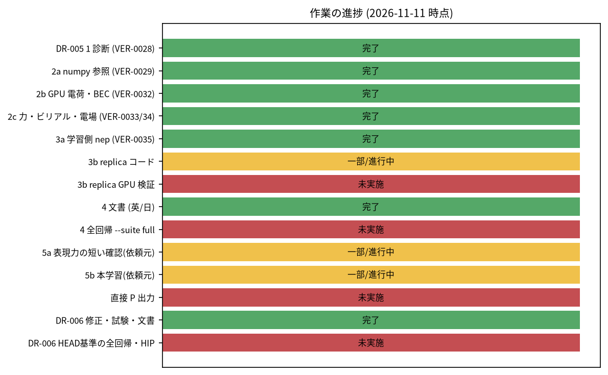

*図 12　作業の進捗（2026-11-11 時点）。緑：完了、黄：一部・進行中、赤：未実施。*

---

## 2. 背景と目的

AC 電場下の PTFE の qNEP-MD（`add_efield <gm> <gid> <file> bec`、`compute_dpdt`）で観測された、ほぼ周波数に依存しない疑似散逸の原因の一つとして、「BEC が P の勾配でない（非保存）」可能性が疑われた。DR-005 は、`dump_xyz ... bec`、`bec.out`、`compute_dpdt`、`add_efield ... bec` が出す BEC を、モデルのただ一つの一価な双極子関数 P(r) の微分にすること、を要求する。受入基準の主なもの：

| 基準 | 内容（DR-005） |
|---|---|
| A1 | BEC と P の有限差分勾配の RMS 差 ≤ 1×10⁻³ e |
| A4 | 同じ構造・`nep.txt` で、`nep` と `gpumd` の BEC が一致（人間が決めた値：BEC ≤ 5×10⁻⁶ e、力 ≤ 1×10⁻⁵ eV/Å、エネルギー ≤ 1×10⁻⁵ eV/原子） |
| A5 | 既存の回帰・テストが通る。BEC を使わない qNEP のエネルギー・力・ビリアルはビット同一 |
| A6 | 再学習後の BEC RMSE の報告（目安：旧 0.073 ± 0.012 e の 2 倍、約 0.15 e。E/F は BEC を優先し数値ゲートなし） |

DR-006 は、同じ日に協力者から報告された dftd3 の異常終了（箱が小箱/大箱の経路のしきい値をまたぐ実行）の修正である。

---

## 3. 作業 1：BEC を P の厳密な勾配にする

### 3.1 診断（段階 1、VER-0028）

生の電荷の有限差分ヤコビアン J[a,k,α] = ∂q_a/∂r_{k,α}（中心差分、gpumd の 1 ステップ実行 6N 回、倍精度ダンプ）を、`zero_total_charge` を無効にした使い捨てのビルドで得て、カーネルの式を検証した（リポジトリのバイナリは変更なし）。

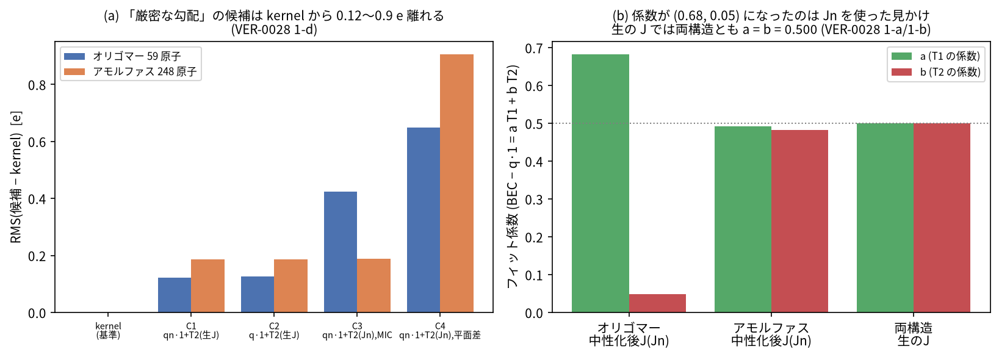

*図 1　(a) 「厳密な勾配」の 4 候補（C1〜C4）とカーネルの差。どれも 0.12〜0.9 e 離れ、並進不変性か局所性のいずれかを満たさない。(b) BEC − q·1 = a T1 + b T2 のフィット係数。中性化後のヤコビアン（Jn）を使うと (0.68, 0.05) になるが、これは見かけで、生の J では両構造とも a = b = 0.500。出典：VER-0028 の 1-a、1-b、1-d。*

要点：

- 依頼元の数値を 5 % 以内で再現（カーネルと厳密勾配の差 RMS 0.430 / 0.188 e）。
- 仮説 H0（現行カーネルの式、生の J）は GPUMD と 0.0003〜0.0005 e で一致（差は δ に反比例して減る FD 雑音）。仮説 H1（H0 + 中性化の項）は 0.431 / 0.029 e の差で**棄却**。
- 非局所項（平均引き）の効果は、33 Å の分子が 40 Å の箱にあるオリゴマーで大きく（RMS 0.43 e）、アモルファスでは小さい（0.03 e）。S_k の RMS は 0.140 / 0.156 e/Å。
- 結論：局所的な BEC が並進不変な P の厳密な勾配になれるのは S_k = 0 のときだけ。**係数の調整では解決せず、モデルの変更（再学習）が必要**。人間が選択肢 D1(a)（総電荷が局所的に保存されるモデルを新設）を決定した（2026-11-11）。

### 3.2 モデルと厳密な BEC（設計 DES-0005、決定 ADR-0006）

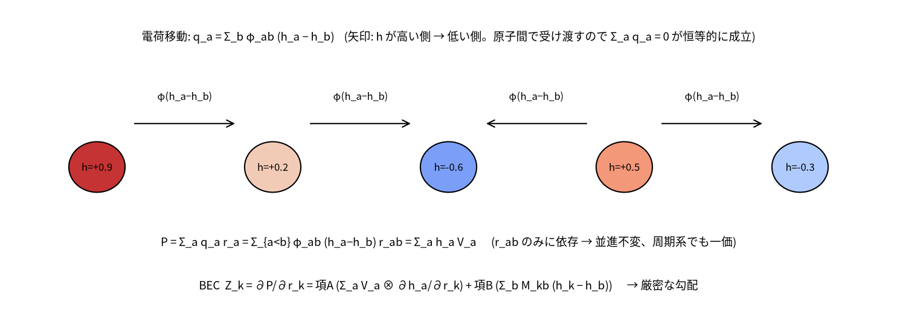

*図 2　`charge_transfer` の概念図。h の高い原子から低い原子へ φ に比例して電荷が移るので、総電荷が恒等的に 0 になる。P は r_ab だけに依存し、並進不変かつ周期系でも一価。*

$$q_a=\sum_b\phi_{ab}(h_a-h_b),\qquad \mathbf P=\sum_a q_a\mathbf r_a=\sum_a h_a\mathbf V_a,\quad \mathbf V_a=\sum_b\phi_{ab}(\mathbf r_a-\mathbf r_b)$$

$$Z_{k,\beta\alpha}=\frac{\partial P_\beta}{\partial r_{k,\alpha}}=\underbrace{\sum_aV_{a,\beta}\frac{\partial h_a}{\partial r_{k,\alpha}}}_{\text{項 A}}+\underbrace{\sum_bM_{kb}(h_k-h_b)}_{\text{項 B}},\quad M_{kb}=\phi'\hat{\mathbf x}\otimes\mathbf x+\phi\,\mathbf 1$$

- **a 中心の和だけ**で書けるので、新たな近傍リストや二段の最小イメージが不要。`rc_desc + rc_phi < L/2` は不要（項 A + B は、通常のカットオフごとの箱の検査を通る任意の箱で厳密）。簡易形（T2 のみ）が厳密になるのは `rc_desc + rc_phi < L/2` のときだけ。
- 対角の q·1 は項 B の `φ·1` に含まれる（別に足すと二重計上）。Z は非対称で、9 成分、添字 `[3β+α] = ∂P_β/∂r_α`。
- 力：`Dt_c = ∂E/∂h_c = Σ_b φ_cb (D_c − D_b)` を既存の力カーネルの重みにし（従来の `D − mean(D)` の代わり）、明示的なペア項 `φ'(r)(h_a − h_b)(D_a − D_b)` を加える。D_a = ∂E_el/∂q_a は Ewald/PPPM が与える。
- 電場：`add_efield ... bec` の力 `F_α = Σ_β bec[3β+α] E_β` は `∇_r(√ε∞ E·P)` なので保守力。`thermo` のエネルギーには −E·P が含まれないため、電場中で保存するのは K+U ではなく **K+U−√ε∞E·P**。
- 設計上のリスク：q = L h（h は局所）の形は、表せる中性の電荷パターンを制限する。実データでの BEC 精度の低下は、段階 5 で確認する（DES-0005 7 節に代替案）。

### 3.3 実装

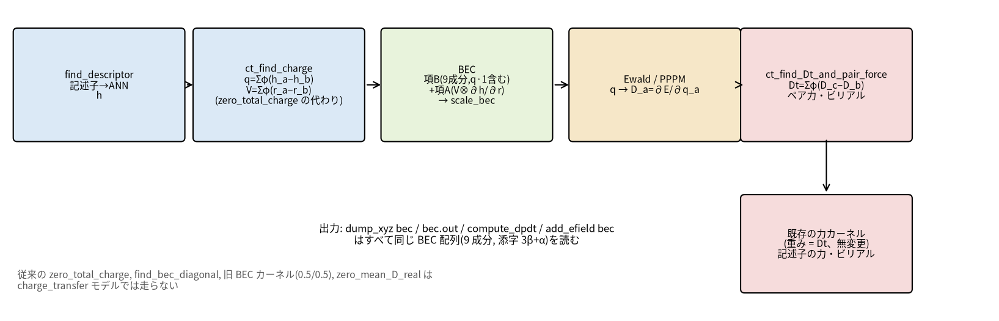

*図 3　`gpumd` の 1 ステップ（`charge_transfer` モデル）。電荷とBEC は `ct_find_charge`、項 B・項 A の BEC カーネルで作り、力は Ewald/PPPM の D から `Dt` と明示的なペア力を作る。新カーネルは `nep_charge_transfer.cuh` に集約し、既存の力カーネルは重みだけ差し替える（カーネル自体は無変更）。*

| 領域 | 内容 |
|---|---|
| `nep.in` | `charge_transfer <rc_phi>`（必須、0 < rc_phi ≤ 動径カットオフ ≤ 100 Å）。`qnep2`/`qnep3` のみ。φ の係数 `N_pair × (basis_size_radial + 1)` 個を、パラメータの末尾に追加（初期値 U[0, 0.1]、他の変数の乱数列は乱さない） |
| `nep.txt` | `cutoff` 行の直後に `charge_transfer rc_phi`、φ ブロックは最後。旧バイナリは明確なメッセージで停止 |
| `gpumd` | 大箱・小箱の両経路。新しい総和は double で累算 |
| `nep`（学習側） | gpumd と同じ算術のカーネルを移植（型が別のため共有ヘッダー不可）。`enforce_nep_total_charge`、`subtract_nep_charge_derivative_mean` は走らない。0 でない `charge=` ラベルは入力エラー |
| `gpumd_replica` | モード 2 のみ。BEC カーネルは移植せず、バッチ積分には入らない |
| 互換性 | 旧モデル・旧入力は電荷・力・エネルギーがビット同一（BEC・ビリアルの下位桁は既存の `atomicAdd` 雑音）。旧カーネルの SASS は定数バンクのオフセットを除き同一 |

### 3.4 検証

検証の方針は、「最も安い診断を先に、各段階に数値ゲートを置き、満たさなければそこで停止して報告する」である（AGENTS.md の段階的測定）。許容値は緩めていない。

**(a) 参照実装（float64、VER-0029）**：乱数の重みで、解析式と中心差分（δ = 1×10⁻⁵ Å）の差が、6 ケースで最大 2.3×10⁻⁹（ゲート 1×10⁻⁸）、Σq ≤ 2×10⁻¹⁵、ΣZ_k ≤ 4×10⁻¹⁵。簡易形（T2 のみ）が厳密なのは `rc_desc + rc_phi < L/2` のケース（差 2×10⁻¹¹）だけで、他は 0.1〜0.9 e 違うことも確認した。

**(b) GPU の BEC（VER-0032）**：

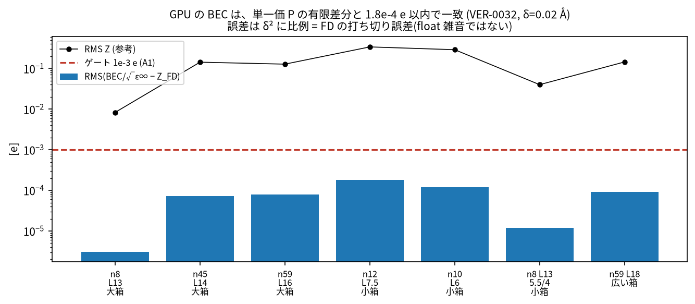

*図 4　GPU の BEC と、単一価 P の有限差分の差（棒）。全構造でゲート 1×10⁻³ e（A1）より 1 桁以上小さい（最大 1.8×10⁻⁴ e）。誤差は δ² に比例する（n12：δ 0.02 で 1.8×10⁻⁴、0.01 で 4.6×10⁻⁵）ので、有限差分の打ち切り誤差で、float の雑音ではない。*

生成器の最初の版は重みが大きく、薄い箱で |q| が最大 5.7 e となり、float の Σq が 2×10⁻⁶ に達した。**ゲートを緩めず**、モデルのスケールを下げて対応した（記録に明記）。

**(c) 力とビリアル（VER-0033/0034）**：

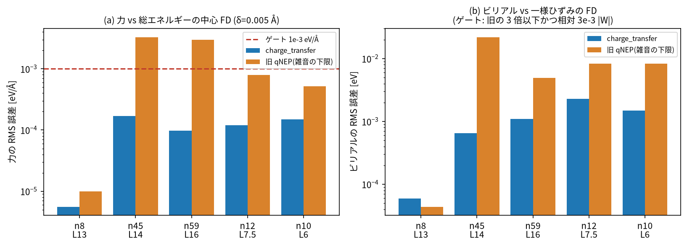

*図 5　(a) 力、(b) ビリアルの、総エネルギーの有限差分との RMS 誤差。「旧」は同じ生成器で `charge_transfer` なしの通常の qNEP（雑音の下限）。力は全構造で旧以下。ビリアルは 5 構造中 4 構造で旧以下（n8 は 1.3 倍でどちらも微小）。*

ビリアルのゲートは、eV 単位で大きさ 4〜13 のため絶対値 1×10⁻³ が意味を持たず、「旧の雑音の 3 倍以下」と「相対 3×10⁻³|W|_RMS」にした（人間の決定。絶対 1×10⁻³ は力にのみ適用）。float64 の参照（VER-0033）では、解析と有限差分が 5 ケースで 1×10⁻⁸ 以内。その有限差分は、2 次精度の中心差分（δ = 1×10⁻⁵）がビリアルの 3 ケースで打ち切り誤差のため届かなかったので、4 次（5 点）にした。

**(d) 電場中のエネルギーと仕事（VER-0034）**：

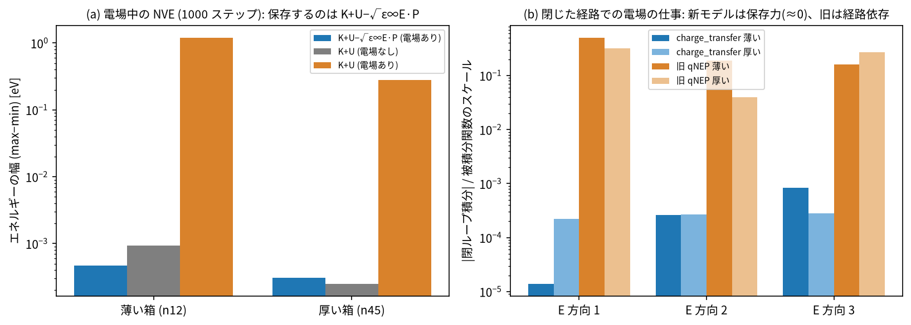

*図 6　(a) 電場中の NVE（1000 ステップ）で保存するのは K+U−√ε∞E·P（電場なしと同じ質）で、K+U だけでは保存しない。(b) 閉じた経路での電場の仕事。新モデルは保存力（積分 ≈ 0、1.4×10⁻⁵〜8.3×10⁻⁴）、旧 qNEP は経路依存（0.04〜0.50）。*

これは、疑似散逸の原因が「BEC の非保存」でありうることの直接の対比だが、**散逸が消えることの証明ではない**（再学習後に依頼元が確認する、DR-005 の範囲外）。

**(e) 学習側と `nep` 対 `gpumd`（A4、VER-0035）**：

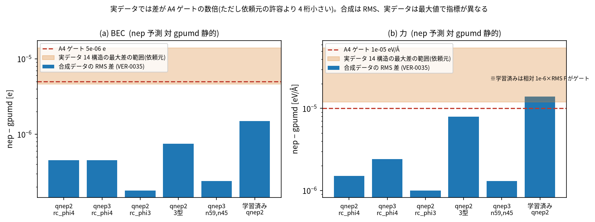

*図 7　`nep` の予測と `gpumd` の静的計算の差。合成データ（青、RMS）はゲートの 10〜100 倍の余裕で一致。依頼元が実データ 14 構造で測った最大差（橙の帯）はゲートの数倍で、原子数が多いほど大きい傾向。指標が RMS と最大値で異なる点に注意。*

変異試験（意図的に誤りを入れて、試験が検出するかを見る）：学習側で項 A 削除（BEC 差 0.185 e）、項 B 削除（0.122 e）、Dt = 0（力差 0.48 eV/Å）、ペア力・ビリアル削除（力差 0.57 eV/Å）の 4 件がすべて A4 で検出された。`gpumd` 側でも、Dt = 0、ペア力削除、ペア項の符号反転の 3 件が、8 件中 6 件の試験を落とした。学習の動作確認（教師-生徒、30/100 世代）では損失が 21.64 → 9.91 / 7.72 に下がり、書き出した `nep.txt` の予測が `loss.out` と一致した。

**(f) 旧モデルへの影響**：旧モデルの静的計算で、電荷・力・エネルギーが旧と新でビット同一（水 63 原子、BaTiO₃ 40 原子、ewald/pppm の 8 回）。学習側も、qnep1/2/3 と通常の nep で、`loss.out`、`nep.txt`、`nep.restart` がバイト同一。

**(g) 独立レビュー**：`numerical-gpu-reviewer`、`physics-dielectric-reviewer`、`api-compat-reviewer` で BLOCKER なし。MAJOR は修正済み（記録は各 VER のレビュー節）。

### 3.5 依頼元の実データ確認で見つかった事項

依頼元が配布バイナリ `bec_rev0`（`93d203d4`）で行った確認の報告（依頼元の測定。GPUMD 側では再現していない）。

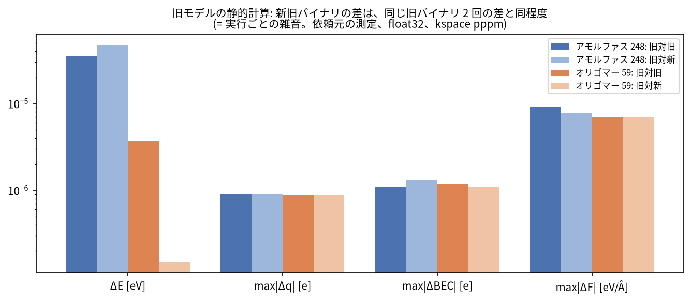

*図 8　旧モデルの静的計算で、旧対旧（同じバイナリ 2 回）と旧対新の差。同程度なので、新旧の差は実行ごとの雑音の範囲（float の `atomicAdd` の順序が原因と推測。未検証）。*

1. **「旧モデルでビット同一」の主張は、小さな箱の静的計算（水 63、BaTiO₃ 40 原子）に限られていた**。依頼元の 248 原子では、旧バイナリ同士でも ΔE 3.5×10⁻⁵ eV、ΔF 9.1×10⁻⁶ eV/Å の差が出る（図 8）。主張を訂正し、配布物の `NOTES_2026-11-11.md` に記載した（返信 3）。
2. **`nep` 対 `gpumd` の差が、実データでは合成データの A4 の数値を超える**（BEC 最大 4.6×10⁻⁶〜1.4×10⁻⁵ e、力 最大 1.2×10⁻⁵〜5.5×10⁻⁵ eV/Å、図 7）。依頼元の許容（BEC の再学習後 RMSE ≲ 0.15 e）より 4 桁小さいが、原因は未切り分け（見立て：float32 の加算順序の雑音が N と |F| で増える。未検証。切り分け案：`gpumd` 同士の差の床の測定）。

### 3.6 再学習の途中経過（依頼元、段階 5）

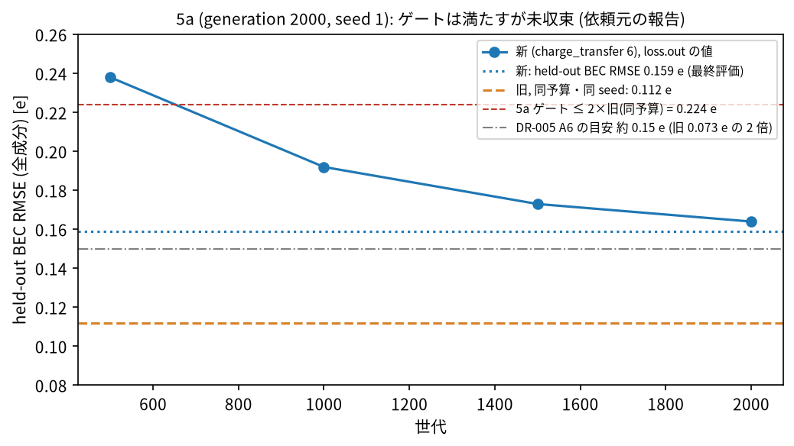

*図 9　5a（N50、`charge_transfer 6`、2000 世代、seed 1）の held-out BEC RMSE。最終評価は 0.159 e で、旧（同予算・同 seed）0.112 e の 1.4 倍、ゲート（≤ 2×）を満たす。ただし未収束（loss.out の値は 0.238 → 0.164 と下降中）、1 seed、held-out 20 構造のみ。*

- 対角成分の C に系統的なずれ −0.28 e（旧 +0.003）、F に +0.13 e。原因（学習の途中か、モデルの表現力の制約か）は**未確定**。5b（10000 世代、seed 1〜3）が実行中。
- E/F RMSE は並記のみ（力 0.330 対 0.409 eV/Å、エネルギー 0.045 対 0.030 eV/原子）。
- 依頼元のデータは Tier P（試作）で、E/F ラベルのライセンスが未確認のため、内部の開発・検証用に限る（再配布・商用モデルの学習には使わない）。

---

## 4. 作業 2：dftd3 の箱経路遷移での異常終了の修正（DR-006）

**問題**：`dftd3` は、周期方向の箱の厚さが `2.5 rc` 以下なら小箱経路（明示的な近傍リスト）、超えれば大箱経路（セルリスト）を使う。`compute_large_box` はセルリストの 6 本の配列を `cn.size() == 0` のときだけ確保し、小箱経路は `cn` だけを確保する。小箱から始めて箱がしきい値を超える実行（`npt_*`、`deform`）では、空の配列が `find_cell_list` に渡り、`force/neighbor.cu:193` の `gpuMemset` が `invalid argument` で異常終了する。協力者の報告：アモルファス PTFE 368 原子、`npt_mttk` で 8 回中 8 回が異常終了（v5.9.1 でも同じ）。

**修正**：確保条件を 2 つに分けた（2 行、`dftd3.cu`）：`cn` 系は `cn.size() == 0`、セルリスト系は `cell_count_radial.size() == 0`。結果の数値は変えない。

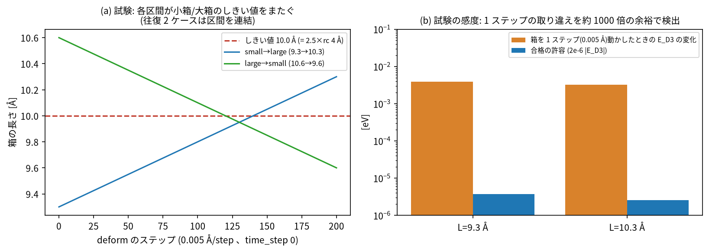

*図 10　(a) 試験の設定：水 27 分子、`dftd3 pbe 4 2`（しきい値 10.0 Å）、`deform` 0.005 Å/step × 200 ステップで、各区間がしきい値をまたぐ。4 経路（小→大、大→小、小→大→小、大→小→大）。(b) 感度：箱を 1 ステップ動かすと E_D3 が 3.9×10⁻³ / 3.2×10⁻³ eV 変わるのに対し、許容は 3.7×10⁻⁶ / 2.6×10⁻⁶ eV（約 1000 倍の余裕）。*

- 判定：区間の終わりで、実行中の D3 エネルギー（D3 あり − なしの 2 本の差）を、ダンプしたフレームの単一経路の静的計算と比べる。許容は DR-001 AC-1 の相対 2×10⁻⁶（緩めない）。
- 結果：修正前は 4 本中、小箱開始の 2 本が `neighbor.cu:193` で失敗、修正後は 4/4 合格（一致は約 5×10⁻⁹ eV）。10 回繰り返して 10/10 合格。協力者の 368 原子の系（箱 28.87 → 32.87 Å）は 4000 ステップを完走。
- 遷移のない実行は、修正前の制御ビルドと `thermo.out`・`f.xyz` がバイト一致（水 27 と大箱、全ゼロ NEP と NEP89、4 構成）。`test_dftd3_reference.py` と `test_dftd3_zero.py` は 101 件合格。
- 独立レビュー（静的）：BLOCKER/MAJOR なし。

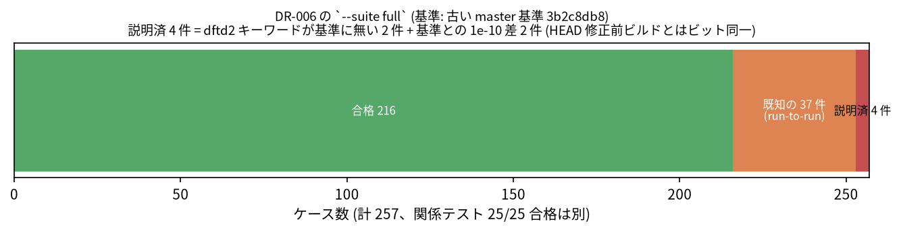

*図 11　`--suite full`（基準は古い master 基準 `3b2c8db8`）の内訳。216 合格、41 失敗。既知の非決定性 37 件（AGENTS.md）のほか、4 件は説明できる（`dftd2` キーワードが基準に無い 2 件、基準との差 ~1×10⁻¹⁰ の 2 件。後者は修正前の HEAD ビルドとビット同一）。**修正前の HEAD を基準にした全回帰は未実施**。*

upstream（v5.9.1 で確認）には同じ不具合が残っている。**upstream への報告・PR は、人間の判断で送っていない**（記録のみ：UPSTREAM-0003）。

---

## 5. 文書

| 文書 | 内容 |
|---|---|
| `doc/nep/input_parameters/charge_transfer.rst`、`doc/theory/qnep_charge_transfer.rst` ほか | 英語の公式マニュアル（キーワード、`nep.txt` 形式、理論、`add_efield`/`compute_dpdt`/`dump_xyz` の BEC の注記）。変更したページの Sphinx ビルドは警告なし（既存の無関係な警告 3 件が別にある） |
| `docs_ja/qnep/` | 本件の日本語マニュアル（背景、使い方、理論、実装、検証、現状と限界） |
| `docs_ja/dftd/` | D2/D3 の日本語マニュアルへ、DR-006 を追補（注意 6 の更新、6.13 節の新設、`D3:n` の行番号 +2 の更新） |
| 依頼元への報告 | `VER-0028-…/REPORT_TO_REQUESTER_ja.md`、`REPLY_TO_REQUESTER_2_ja.md`、`VER-0035-…/REPLY_TO_REQUESTER_3_ja.md` |

---

## 6. 作業の進め方と判断の記録

- **段階的・数値ゲート**：診断 → numpy 参照 → GPU の BEC → 力・ビリアル → 学習側 → replica。各段階に数値ゲートを置き、満たさなければ停止して報告した（例：ビリアルが絶対 1×10⁻³ を超えたときは、緩めずに報告し、人間が基準を決めた）。
- **人間の判断を要した主な決定**：D1(a)（モデルを新設して再学習する）、ビリアルのゲート（旧の 3 倍以下かつ相対 3×10⁻³）、学習済みモデルの A4 の力のゲート（相対 1×10⁻⁶ × RMS F）、φ 係数を `basis_size_radial + 1` 個/ペアにすること、replica のゲート（|ΔE|/N ≤ 1×10⁻⁴、RMS ΔF ≤ 1×10⁻⁴ eV/Å、RMS ΔW/RMS W ≤ 1×10⁻⁴）。
- **コミット・push は指示があるたびに実施**。`--suite full` は人間の合図まで、再学習の終了まで開始しない。再学習中は GPUMD 側の GPU 作業を止める。
- **非公開・制限**：依頼元の学習データ・モデルは内部の開発・検証用に限る。upstream への報告は送らない。

---

## 7. 限界・リスク・今後

| 区分 | 内容 |
|---|---|
| 実データでの表現力 | 未確認。q = L h の制約で BEC の精度が落ちる可能性。5a は途中（ゲート内、未収束）、5b は実行中。C の対角 BEC のずれの原因は未確定 |
| 疑似散逸の解消 | 未確認（BEC の保存性は確認したが、散逸の他の原因は排除していない。依頼元の再試験 T1〜T6 が必要） |
| 検証データ | すべて合成データ。float と double の比較なし。実データでは `nep` 対 `gpumd` の差が A4 の数倍（原因未切り分け） |
| `gpumd_replica` | コードのみ。GPU 検証は未実施（再学習の終了後）。`charge_mode 3` は非対応。配布済み `bec_rev0` の replica は `charge_transfer` を受け付けない版 |
| 全回帰 | 未実施（DR-005、DR-006 とも。基準は修正前の HEAD。既知 37 件のリストの再測定を含む） |
| 周期系の P そのもの | 未実装（`thermo` のエネルギーに −E·P は含まれない） |
| HIP | 未検証（この機械に hipcc なし） |
| 非決定性 | 大きな系で旧バイナリ同士も ΔE 3.5×10⁻⁵ eV の差。原因（セルリストや PPPM の `atomicAdd` の順序）は仮説で未検証 |
| upstream への PR | 未作成。テストが `specs/` の生成器に依存するため、PR の段階で再配置する（決定済みで延期）。`specs/`、`.claude/` は PR に含めない |

今後の順序：(1) 再学習の終了後に replica の GPU 検証、(2) 人間の合図で全回帰（HEAD 基準、既知リストの再測定）、(3) `nep` 対 `gpumd` の差の床（`gpumd` 同士）の測定、(4) 5b の結果を受けた C の対角 BEC のずれの見立て、(5) 直接の P の出力（承認済み、インターフェース未確定）。

---

## 8. 成果物とコミット

| 項目 | 場所・コミット |
|---|---|
| DR-006 の修正 | `b90c2920`（`src/force/dftd3/dftd3.cu` の 2 行、`tests_pytest/test_dftd3_cell_buffers.py`） |
| DR-005 | `4a721a48`（仕様・設計・ADR）、`480ba096`（traceability）、`d6bcbb1f`（2b）、`0a4666a1`（2c）、`7b08550f`（3a）、`dd11ae7c`（文書）、`338e7955`（3b コード）。各段階の traceability と返信文は `07c27621`、`93d203d4`、`94027fd7`、`e6e5ca37` |
| 検証記録 | `specs/verification/VER-0028`〜`VER-0036`（VER-0031 は別の分解の記録） |
| 日本語マニュアル | `a74ee293`（`docs_ja/dftd`）、`eab8478a`（`docs_ja/qnep`） |
| 配布バイナリ | `/home/katouda/bin/GPUMD/bec_rev0/`（`93d203d4` から。変更しない） |
| 環境 | RTX A6000（sm_86）、CUDA 12.3、float32 ビルド、`make CUDA_ARCH="-arch=sm_86" -j4`（警告は既存の `force/eam/eam_alloy.cu:42` のみ） |

## 付録：図の出典

| 図 | 出典 |
|---|---|
| 1 | VER-0028（1-a、1-b、1-d の表） |
| 2、3 | DES-0005、VER-0032、VER-0034 |
| 4 | VER-0032 |
| 5、6 | VER-0034（Gate 1〜3、電場の追記） |
| 7 | VER-0035（A4 の表）、依頼元の報告 2 章（実データ） |
| 8、9 | 依頼元の報告 1 章、3 章 |
| 10、11 | VER-0030 |
| 12 | `specs/traceability.yaml` と本書 7 章 |

図の再生成：`/home/katouda/miniforge3/envs/py312-gpumd/bin/python docs_ja/workreport/scripts/make_figures.py`（matplotlib、フォント Noto Sans CJK JP）。
